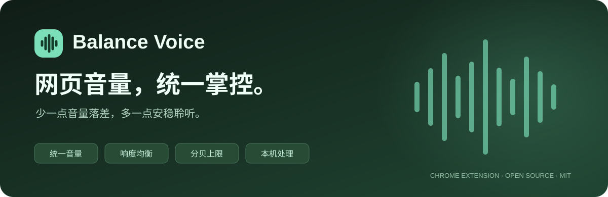
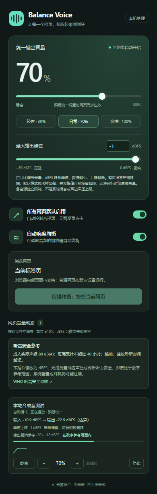

<div align="center">



**从视频切到音乐，不必再追着音量滑块跑。**

让常见网页音视频自动使用统一音量，平衡强弱，限制数字峰值。打开一个面板，查看和调节多个网页。

[](https://developer.chrome.com/docs/extensions/)
[](extension/manifest.json)
[](extension/manifest.json)
[](LICENSE)

[快速安装](#快速安装) · [功能说明](docs/USAGE.md) · [反馈问题](https://github.com/tyrantqiao/balanceVoice/issues) · [推广文案](docs/PROMOTION.md)

</div>

## 网页一换，音量就得重新调？

课程声音太轻，下一个视频突然变响；音乐、直播、短视频各有各的音量。Balance Voice 把常用的调音操作集中到一个 Chrome 扩展里，让你少一些来回调整，多一点安稳聆听。

- **默认自动管理**：普通网页里的音视频自动使用统一设置，无需逐页点击。支持动态播放器和匹配的 iframe。
- **一个面板，多个网页**：查看各页输入/输出电平和近期变化曲线，直接静音、调高、调低，或停止管理。
- **百分比 + 分贝上限**：0–100% 调整音量，−60～0 dBFS 设置数字输出峰值上限；单独调整某页也受上限约束。
- **响度自动平衡**：压低响声，适度提升轻声；需要时可接管整页音频，在音频线程中均衡和限幅。
- **工具栏数字标**：直接看到正在管理的网页数，关闭弹窗后仍更新，同页多个播放器只计一次。
- **音频留在本机**：无需账户，不录音、不上传音频，没有第三方运行依赖。

## 看看界面

<p align="center">
  
</p>

截图来自本地合成音测试。网页列表中的「− / +」每次调整 10 个百分点；「跟随统一」可恢复全局联动。

## 快速安装

需要 **Chrome 116 或更高版本**。当前通过开发者模式加载源码；暂未提供 Chrome 网上应用店安装入口。

1. [下载项目源码 ZIP](https://github.com/tyrantqiao/balanceVoice/archive/refs/heads/main.zip)，解压到一个长期保留的目录；也可克隆仓库：

   ```sh
   git clone https://github.com/tyrantqiao/balanceVoice.git
   ```

2. 在 Chrome 地址栏打开 `chrome://extensions/`，开启右上角「开发者模式」。
3. 点击「加载已解压的扩展程序」，选择项目内的 **`extension` 文件夹**，不要选择整个仓库。
4. 在扩展菜单中固定 Balance Voice，刷新已打开的网页。保留「所有网页默认启用」开启，即可自动管理普通音视频。

**安装和使用扩展无需 Node.js，也无需构建。** 默认设置为 70% 音量、−1 dBFS 峰值上限。可先从较低的系统音量开始，按实际听感调节。

更新源码后，在扩展管理页点击重新加载，再刷新已打开的网页；如 Chrome 询问网站访问范围，请允许扩展在需要自动管理的网站运行。请保留安装目录，扩展会直接读取其中的文件。

## 两种管理方式，按需使用

| | 默认自动模式 | 增强均衡：整页接管 |
| --- | --- | --- |
| 开启方式 | 默认开启，无需逐页点击 | 关闭自动模式后，在目标网页点击接管 |
| 处理范围 | 文档中的普通 HTML 音视频播放器 | 当前标签页完整音频，包括 Web Audio |
| 响度均衡 | 可读取音频时自动分析并调整播放器音量 | 通过 AudioWorklet 处理 |
| 分贝上限 | 约每 25 ms 采样调整，突发峰值可能短暂超限 | 音频线程限制数字采样峰值 |
| 音频无法分析时 | 保守衰减播放器音量，不能验证峰值 | 捕获失败会显示错误 |

百分比是播放增益，dBFS 是数字信号电平。**分贝上限按受管理音源独立生效，不是多个网页或系统混音后的总上限。** 停止管理的网页不再受扩展上限约束。

默认模式开启时，面板直接展示网页音量列表，不再重复提示接管。需要整页接管时，可先关闭默认模式，手动接管后再重新开启默认模式；已接管网页仍保留停止入口。

## 关于听音安全与兼容性

插件不能测量耳边声压，**dBFS 不等于 dB(A)**。数字电平处于参考范围，不代表系统音量或耳机一定安全。面板提供 [WHO 听音安全参考](https://www.who.int/news-room/questions-and-answers/item/deafness-and-hearing-loss-safe-listening)，同时明确标注读数局限。

默认模式无法覆盖纯 Web Audio、未接入文档的播放器、封闭 Shadow DOM；跨域或 DRM 内容也可能禁止分析。浏览器内部页面、本地文件不受支持。响度均衡采用 RMS，并非 LUFS 测量，不保证不同声音的主观听感完全一致。

完整的使用方式、上限精度、状态保存、权限说明见 [使用手册](docs/USAGE.md)。

## 隐私与权限

音频仅在本地实时处理，不保存音频文件、不接入分析服务。全局设置保存在本机，单页控制和管理计数保存在浏览器会话中。文档中的外部参考链接仅在点击时打开。

| 权限 / 访问范围 | 用途 |
| --- | --- |
| `activeTab`、`tabCapture` | 用户调用扩展后接管当前标签页音频 |
| `offscreen` | 关闭弹窗后继续处理和播放被接管的音频 |
| `storage` | 保存音量、分贝上限及控制状态 |
| HTTP / HTTPS 内容脚本 | 在网页及匹配子框架中自动控制音视频 |

不读取表单、密码或账户信息，不发送网页内容，不绕过跨域和内容保护。

## 开发与验证

无第三方运行依赖。基础测试与打包需要 Node.js 20+：

```sh
npm test
npm run check
npm run package
```

打包结果为 `dist/balance-voice-1.4.2.zip`，解压后加载；它不是可双击安装的签名 CRX。

浏览器集成测试默认使用 Windows 本机 Chrome，也可通过 `BROWSER_PATH` 指定浏览器路径。测试在独立临时配置中加载扩展，不使用个人浏览器配置；脚本使用实验性 DevTools 扩展接口，需浏览器支持。

```sh
npm run test:browser -- --auto --audio
```

已验证：默认模式徽标、iframe 去重与清理、单页控制、设置保存、RMS 响度收敛、突发峰值保护及分贝上限。详见 [浏览器验收清单](docs/ACCEPTANCE.md)。

| 主要文件 | 职责 |
| --- | --- |
| `extension/automatic.js` | 默认网页播放器控制与音频分析 |
| `extension/background.js` | 状态、徽标、设置同步与捕获生命周期 |
| `extension/offscreen.js` | 后台音频流管理 |
| `extension/dsp.js` | 响度均衡、平滑与峰值限制 |
| `extension/popup.*` | 中文面板与网页音量列表 |

## 一起改进

遇到兼容性问题，欢迎 [提交 Issue](https://github.com/tyrantqiao/balanceVoice/issues)，附上 Chrome 版本、网页类型、使用模式和复现步骤；请勿上传隐私音频、账户或令牌。也欢迎提交改进播放器兼容性、测试和文档的 PR。

如果 Balance Voice 减少了你的调音次数，欢迎给项目一个 Star，或把它分享给经常在浏览器里看课、听歌、看直播的朋友。

> **Balance Voice** — A local-first Chrome extension for consistent audio across web media, with automatic leveling, per-tab controls, and a configurable digital peak ceiling. No account or audio uploads required.

## 开源协议

[MIT License](LICENSE) · Copyright © 2026 qiao
